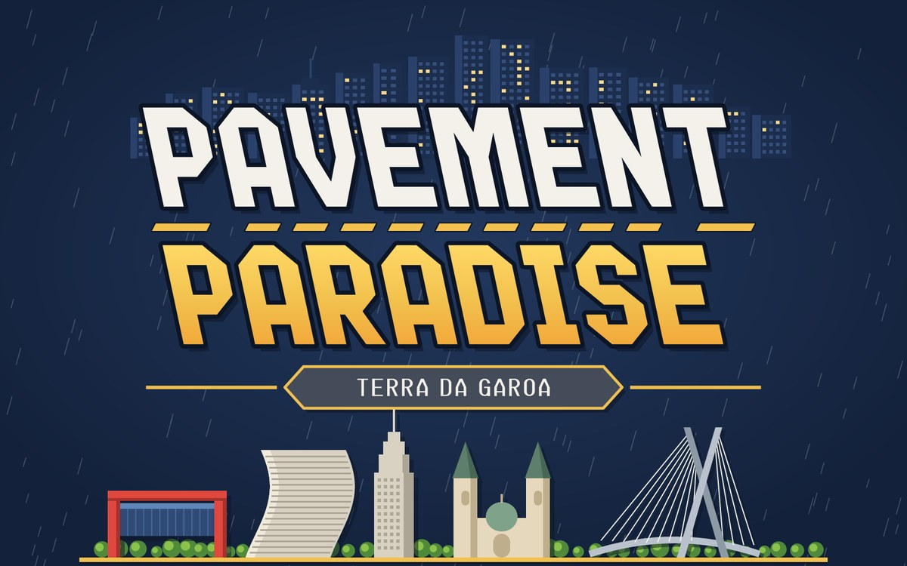
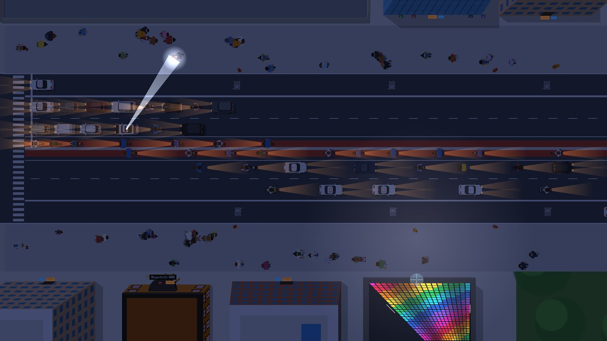
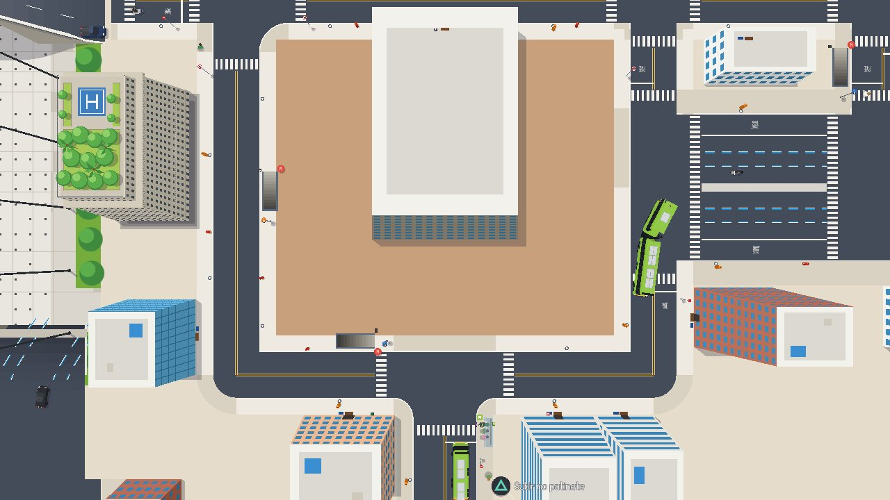
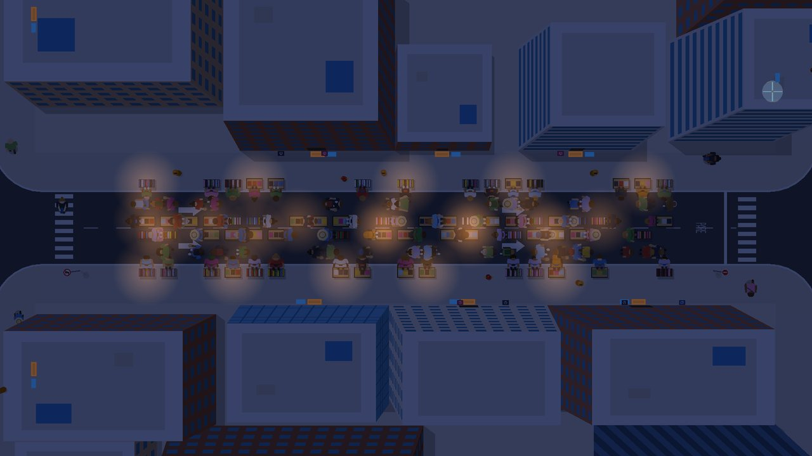
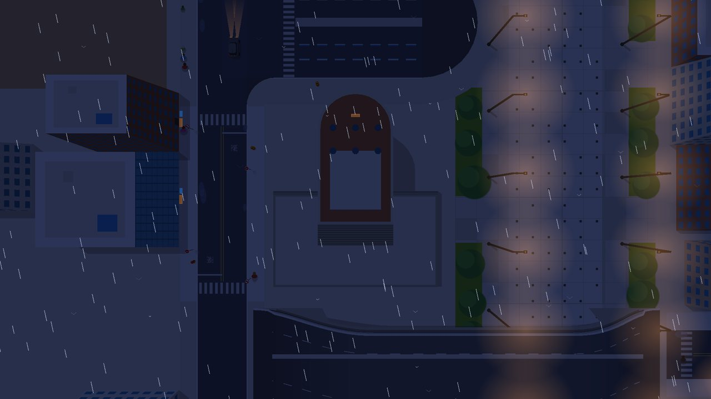
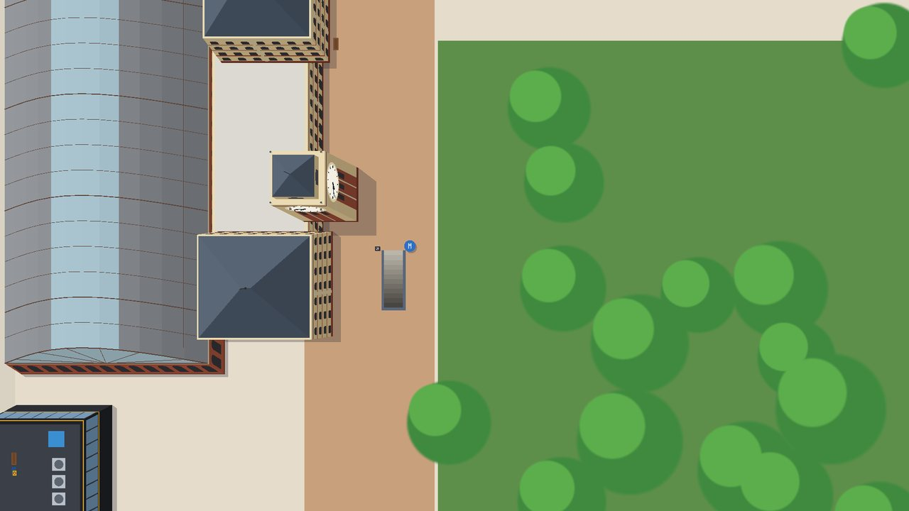
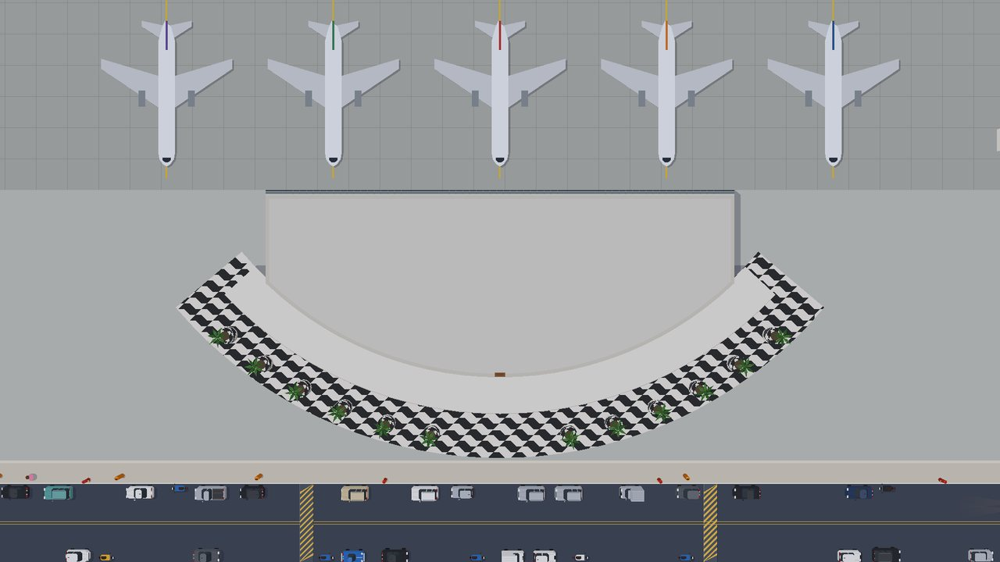

### A cidade vive sem você. Mas percebe você.
*The city lives without you. But it notices you.*

**[🌐 pavementparadise.com](https://pavementparadise.com)** · [Português](#português) · [English](#english)

---

## Português

**Pavement Paradise: Terra da Garoa** é um jogo indie brasileiro de **cidade viva** nas ruas de São Paulo.
Cada morador, ônibus, padaria e semáforo segue a própria rotina. Você anda, pega o metrô, dirige e, se quiser,
bagunça tudo. **Lançamento em 25 de janeiro de 2027**, aniversário de São Paulo, para PC na Steam.

  
  

### Tudo o que você faz espalha

Ninguém aqui espera o jogador. A cidade acorda, trabalha e volta para casa sozinha. Quando você entra na
história, ela reage, e o efeito corre de rua em rua:

> Você para o carro em fila dupla → a rua trava → o ônibus desvia → alguém perde a hora do trabalho.

- 🚶 **A pé pela cidade.** Calçada de pedra portuguesa, faixa de pedestre e prédios que se abrem quando você entra:
  o telhado some e mostra o interior.
- 🚇 **Metrô e ônibus.** Bilhete, catraca, baldeação e a viagem dentro do vagão. No ônibus, dá sinal e desce em qualquer parada.
- 🚗 **Carro, moto e bicicleta.** Respeite o semáforo e a mão da rua, ou não. O trânsito reage: buzina, desvia, freia em cima.
- 🌧️ **Terra da garoa.** Dia e noite, garoa que chega do nada, tempestade de verão e enxurrada.
- 🚨 **Tudo tem consequência.** Testemunha liga para a polícia, o dono do carro corre atrás e a viatura entra na caçada.
  Violência só de desenho animado: "PÁ!" e estrelinhas.
- 🏠 **Uma vida para cuidar.** Casa, cama, fome, sono, celular e inventário. Faça bicos para pagar as contas.
- 📓 **Caderno da Cidade.** Descubra e anote a rotina dos moradores: a padaria lota às 7h, a feira tem dia certo.
- 🏁 **Quando a cidade dorme.** Rachas de madrugada, oficina de tunagem, e coisas que só acontecem bem tarde.

  
  
  

### Uma pessoa só. Uma cidade inteira.

Programação, arte, som, mapa e cada morador da cidade: tudo feito por **uma pessoa só**, aqui no Brasil,
em [Godot 4](https://godotengine.org). A arte é toda desenhada por código, num estilo flat com falso 3D: os prédios
"giram" de leve enquanto você anda.

**João Rangel**, criador do jogo · [GitHub](https://github.com/joaohcrangel) · [LinkedIn](https://www.linkedin.com/in/joaohcrangel/)

### Como acompanhar

- ⭐ Dê uma **estrela** neste repositório.
- 🌐 Visite **[pavementparadise.com](https://pavementparadise.com)**: fotos, trailer e a página da Steam assim que abrir.
- 💛 Quando a página da Steam abrir, **adicione à lista de desejos**: é o que mais ajuda um jogo indie.

---

## English

**Pavement Paradise: Terra da Garoa** ("land of drizzle", São Paulo's nickname) is a Brazilian indie
**living-city** game set on the streets of São Paulo. Every citizen, bus, bakery and traffic light follows its own
routine. Walk, ride the subway, drive and, if you feel like it, mess everything up.
**Launching January 25, 2027**, São Paulo's birthday, on PC via Steam.

- 🏙️ **A city that doesn't need you, but notices you.** Double-park and the street jams, the bus detours, someone is late for work.
- 🚇 **Subway, buses, cars, bikes:** tickets, turnstiles, transfers, traffic lights and traffic that reacts.
- 🌧️ **Day, night and sudden drizzle**, summer storms and flooded streets.
- 🚨 **Consequences, cartoon style:** witnesses call the police, owners chase you, "POW!" and dizzy stars, never blood.
- 📓 **No main story:** the city *is* the story. Learn its routines, take odd jobs, race at night.
- 🇧🇷 **Made by a single developer** in Brazil, in Godot 4, with all art drawn by code.

  

**João Rangel**, creator · [GitHub](https://github.com/joaohcrangel) · [LinkedIn](https://www.linkedin.com/in/joaohcrangel/)
· Star this repo and visit **[pavementparadise.com/en](https://pavementparadise.com/en/)**.

---

Este repositório guarda só o site já pronto (publicado automaticamente pelo GitHub Pages); o código do jogo é
privado. Ruas e bairros têm nomes reais; sem relação com marcas, empresas ou instituições reais.
· This repository only holds the built website (deployed automatically to GitHub Pages); the game's source code is
private. © João Rangel.
